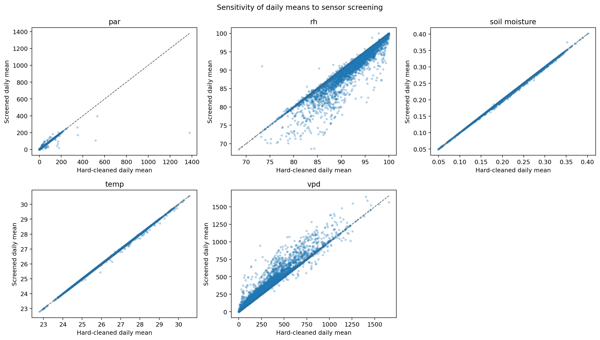
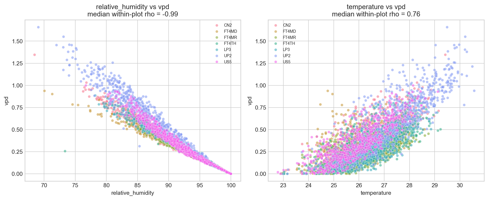
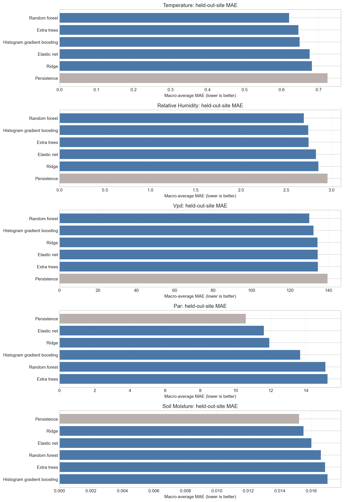
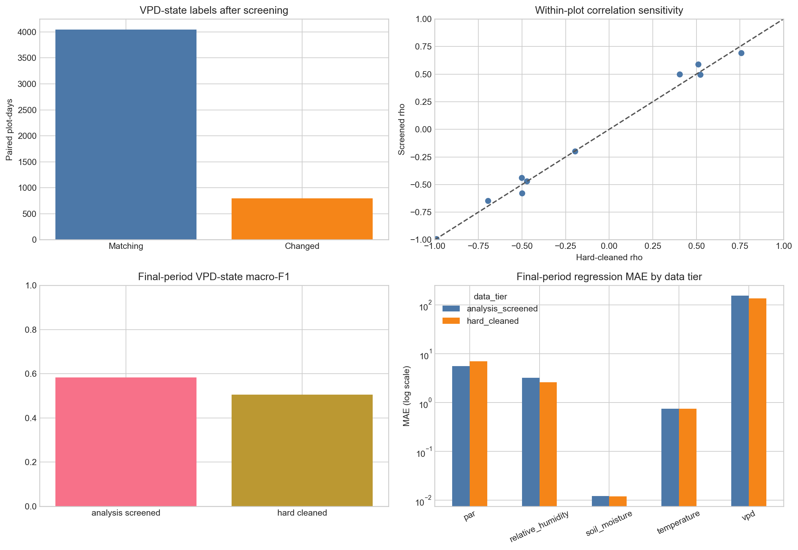

# Forest Restoration Using AI: CCNR Microclimate Study

An auditable data-science study of forest microclimate records from seven Central Catchment Nature Reserve (CCNR) plots in Singapore. The project turns a large sensor record into daily environmental evidence, sensitivity checks and honest short-horizon prediction baselines.

> **Scope.** This repository studies measured microclimate, not tree health. The supplied material has no matched survival, growth, canopy, rainfall, LiDAR, imagery, maintenance or calibration labels. Results describe the monitored plots and period; they are not ecological causal claims or a tree-stress model.

## Highlights

| Item | Verified result |
| --- | --- |
| Source record | 1,002,949 time-stamped observations across 7 plots |
| Primary analysis tier | 1,002,899 hard-cleaned records; 50 confirmed-invalid rows removed |
| Sensitivity tier | 920,216 review-screened records, used only to test sensitivity |
| Daily coverage | 4,852 plot-days for temperature/RH/VPD; 2,897 for PAR; 2,661 for soil moisture |
| Strongest daily association | Median within-plot Spearman rho = -0.991 for RH-VPD |
| Final-period prediction | Persistence selected for temperature, RH, VPD and soil moisture |
| Site-transfer benchmark | Random Forest led for temperature, RH and VPD; persistence led for PAR and soil moisture |

## Selected results

### Quality-policy sensitivity

The primary tier retains questionable-but-possible readings with traceable flags. A stricter screened tier is a sensitivity check, not a replacement dataset. At daily scale, temperature and soil moisture are nearly unchanged, while RH and VPD are more sensitive to screening.



### Within-plot microclimate relationships

Associations are estimated on daily plot-level summaries with a 14-day moving-block bootstrap (500 repeats). The RH-VPD relationship is structurally expected because VPD depends on temperature and RH; it is reported descriptively, not as independent causal evidence.



| Relationship | Paired plot-days | Median within-plot Spearman rho |
| --- | ---: | ---: |
| RH-VPD | 4,852 | -0.991 |
| Temperature-VPD | 4,852 | 0.757 |
| VPD-soil moisture | 2,661 | -0.501 |

### Forecasting and robustness

Forecasts use chronological 60/20/20 train/validation/final-test splits. The untouched final period contains 776 rows for temperature, RH and VPD, 160 for PAR and 152 for soil moisture. Persistence is retained as a genuine candidate, and the selected PAR Random Forest **did not** beat it on the final period (MAE was 54.1% worse). This negative result is kept deliberately.





The separate VPD-state task evaluated 778 untouched final-period rows: logistic regression achieved 0.594 balanced accuracy, 0.505 macro-F1 and 0.816 macro one-vs-rest AUC. It predicts a next-day environmental category, not a biological condition.

## Methods

1. Preserve the supplied source and record provenance.
2. Remove only confirmed-invalid rows; retain review flags for unusual but plausible values.
3. Aggregate to daily plot-level observations before EDA, associations and forecasting.
4. Compare hard-cleaned primary evidence with a review-screened sensitivity tier.
5. Analyse within-plot relationships, drydown events and exploratory PCA regimes.
6. Evaluate next-day models with chronological splits and a separate leave-one-site-out benchmark.

See [the executed notebook](notebooks/clean_microclimate.ipynb), [the reproducibility manifest](outputs/redesigned/reproducibility_manifest.md), and the [environment note](docs/environment.md) for the full analytical trail.

## Repository layout

```text
notebooks/     Executed end-to-end microclimate analysis
scripts/       Cleaning, sensitivity, statistics, drydown and forecasting modules
tests/         Behavioural and notebook-integration checks
outputs/       Curated result figures, concise tables and run manifest
docs/          Report-generation sources, environment and report assets
data/metadata/ Small plot-level metadata only
```

Large local datasets, trained models, backups and exhaustive generated prediction files are intentionally excluded from new commits. They can be regenerated from the supplied source record by running the notebook.

## Reproduce

The verified run used macOS, Python 3.10.5, R 4.5.2 and the packages pinned in `requirements.txt`.

```bash
python3 -m pip install -r requirements.txt
python3 -m unittest discover -s tests -v
```

Open `notebooks/clean_microclimate.ipynb` with the documented Jupyter kernel to reproduce the full output set. The final run reads the local `ccnr_microclimate_data.Rdata` source through `Rscript`; see [data/README.md](data/README.md) before attempting to redistribute or replace any data files.

## Limitations and responsible use

- Sensor identifiers describe the supplied record, not a verified physical deployment log.
- No rainfall, soil calibration/depth, biological outcomes or remote-sensing products were supplied.
- Leave-one-site-out and chronological prediction answer different questions and must not be compared as interchangeable validation scores.
- This work is a reusable environmental-monitoring baseline for a later restoration study, not a deployment-ready decision system.

## Report

The report is generated from the tracked Word-generation sources in `docs/`. Its editable cover page intentionally retains student and supervisor placeholders until the author completes them. The report source was rendered and visually checked at 53 pages in the final project review.
